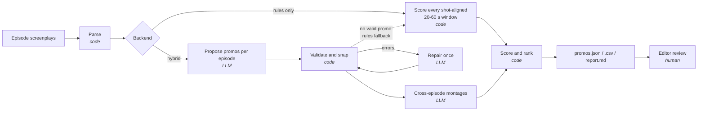

# Promo Finder

[](https://github.com/sahilkumariitr/kuku-promo-finder/actions/workflows/ci.yml)


[](https://kuku-promo-finder-23119038.streamlit.app)

**Promo Finder reads the timestamped screenplays of a vertical microdrama and returns a ranked list of
ready-to-cut promo clips** for TikTok, Reels and Shorts, with exact segment timestamps, the hook, the
cliffhanger and a one-line reason for each.

**Live demo:** <https://kuku-promo-finder-23119038.streamlit.app>. Upload a `.zip` of episode screenplays
(try [`tests/fixtures/synthetic_show`](tests/fixtures/synthetic_show), zipped) and press **Find promos**. The
rules backend needs no key; the LLM backend takes your own key, used only for that session.

Built for the Kuku AI Generalist assignment (Problem 1: *Find the Promos*). Today an editor watches every
episode to pick promo moments by hand; this tool produces a shortlist for a whole show in seconds so the
editor only reviews the top of the list.

A promo, as defined in the brief, is a 20–60 s clip that:

1. **opens on a hook**: something in the first 3 seconds stops a scrolling viewer;
2. **ends on a cliffhanger**: it cuts at an unresolved moment;
3. **stands alone**: it makes sense to someone who has never seen the show.

---

## Contents

- [Highlights](#highlights)
- [Quick start](#quick-start)
- [How it works](#how-it-works)
- [Output](#output)
- [Configuration and model swapping](#configuration-and-model-swapping)
- [Free tiers and rate limits](#free-tiers-and-rate-limits)
- [Evaluating quality](#evaluating-quality)
- [Results on the provided show](#results-on-the-provided-show)
- [Limitations](#limitations)
- [Project structure](#project-structure)
- [Further reading](#further-reading)

## Highlights

- **Model-agnostic.** Any OpenAI-compatible endpoint (Gemini, Groq, OpenRouter, OpenAI, a local Ollama
  model, or a company gateway). Swapping models is one flag or environment variable.
- **Never trusts the model's timestamps.** Every proposal is validated in code: cuts snap to shot
  boundaries, never end mid-line, stay within 20–60 s, and must put a line or action in the first 3 s.
  Invalid proposals go back to the model once with the exact errors.
- **Runs a whole show on a free tier.** Episodes are batched 10 per request (~6 requests per show), requests
  are paced to the provider's per-minute limit, finished requests are cached so an interrupted run resumes
  for free, and an overloaded or exhausted model hands over to a fallback model.
- **Works without an API key.** A deterministic rules backend scores every shot-aligned window. It is
  the free fallback and the baseline the LLM has to beat.
- **Cross-episode promos.** The LLM can join moments from different episodes into one clip.
- **Auditable.** Every prompt and unedited model response is saved to `raw_llm/`.
- **Zero runtime dependencies.** The pipeline is pure Python standard library; Streamlit is optional.
- **Measurable.** A built-in evaluator compares output to an editor's own picks (recall and precision).

## Quick start

Requires Python 3.9+.

```bash
git clone https://github.com/sahilkumariitr/kuku-promo-finder.git
cd kuku-promo-finder
pip install -e ".[app,dev]"
```

**1. Try it on the bundled synthetic show (no key needed):**

```bash
promo-finder --input tests/fixtures/synthetic_show --out outputs/demo --backend rules
```

**2. Run on a real show with an LLM.** A free Gemini key from
[Google AI Studio](https://aistudio.google.com/apikey) is enough:

```bash
echo "GEMINI_API_KEY=your-key" > .env      # or: export GEMINI_API_KEY=your-key
promo-finder --input path/to/show_folder --out outputs/llm --backend llm
```

Keys are read from the environment or a git-ignored `.env` file in the working directory.

**3. Use the web app** ([hosted version](https://kuku-promo-finder-23119038.streamlit.app)). Upload a `.zip`
of episode screenplays, then inspect each promo next to its script. While it runs, a live copy of the
flowchart under [How it works](#how-it-works) shows which stage is active, what each stage produced, and
any stage that fails or is skipped:

```bash
streamlit run app.py
```

Common flags:

| Flag | Purpose |
|---|---|
| `--backend llm\|rules` | LLM proposals (default) or the no-key rules search |
| `--provider gemini\|groq\|openrouter\|openai\|ollama` | choose a preset endpoint |
| `--model NAME` | override the provider's default model |
| `--episodes 1-10` | process a subset |
| `--no-montages` | skip cross-episode promos |
| `--config config.toml` | override any setting (see `config.example.toml`) |

### Input format

One `.txt` file per episode, in Kuku's screenplay format: a header (`EPISODE NUMBER`, `EPISODE LOGLINE`,
`CONTINUITY NOTES`), scenes, and blocks such as:

```
**CAMERA:**
Start: (00:04.80) | End: (00:06.80)
Close-up on her face as the smile fades.

**CHARACTER NAME (Cold, Commanding):**
Start: (00:11.30) | End: (00:13.10)
"A line of dialogue."
```

See [`tests/fixtures/synthetic_show`](tests/fixtures/synthetic_show) for two complete (original, synthetic) episodes.

## How it works



| Stage | Done by | Why |
|---|---|---|
| Parse blocks into (episode, start, end, kind, speaker, emotion, text) | code | the format is regular; free and never wrong |
| Propose promos with hook, cliffhanger, reason and 1–5 scores | LLM | "would a stranger stop scrolling and follow this?" needs language understanding |
| Snap to shot boundaries, forbid ending mid-line, enforce 20–60 s, check the first 3 s, reject non-existent timestamps | code | models invent or fudge timestamps; rules are cheap and certain |
| Fix rejected proposals | LLM, one round | validator errors are sent back verbatim |
| Rule features: emotion-tag intensity, physical action, reveal words, music stings, episode-end cliffhangers, mid-conversation openings | code | a second opinion blended into the score, so one odd LLM answer cannot top the list |
| Posting order | code | score, plus a small bonus for early episodes and a diversity penalty so neighbouring posts come from different scenes |
| Final selection | human | the tool shortlists ~3 per episode and flags low-confidence picks |

Design decisions and trade-offs are explained in [`docs/DESIGN.md`](docs/DESIGN.md).

## Output

Each run writes to the `--out` folder:

| File | Contents |
|---|---|
| `promos.json` | all promos plus run metadata (model, calls, token usage, config) |
| `promos.csv` | one row per promo, for editors and spreadsheets |
| `report.md` | "post first" top 10 and the full ranked table |
| `raw_llm/*.json` | LLM backend only: every prompt and unedited response, including repair rounds |

One promo in `promos.json`:

```json
{
  "rank": 1,
  "id": "P001",
  "kind": "single",
  "episodes": [1],
  "segments": [{"episode": 1, "start": "00:36.50", "end": "01:01.50", "start_s": 36.5, "end_s": 61.5}],
  "duration": 25.0,
  "hook": "GUEST (Mocking): \"Look at her. Pathetic.\"",
  "cliffhanger": "VICTOR (Shocked, Whispering): \"No... it can't be you.\"",
  "why": "Opens on a mocking line; uses the episode's own cliffhanger ending.",
  "llm_scores": {},
  "rule_scores": {"hook": 0.92, "cliffhanger": 0.84, "standalone": 0.84, "duration_fit": 1.0},
  "score": 0.922,
  "flags": []
}
```

This is the top pick from the rules backend on the synthetic show. With the LLM backend, `llm_scores`
holds the model's 1–5 ratings for `hook`, `cliffhanger` and `standalone`.

Full field reference: [`docs/OUTPUT_FORMAT.md`](docs/OUTPUT_FORMAT.md). A complete example run on the
synthetic show is in [`examples/synthetic_output`](examples/synthetic_output).

## Configuration and model swapping

Every endpoint is OpenAI-compatible, so changing models never touches code:

```bash
promo-finder ... --provider groq                     # needs GROQ_API_KEY
promo-finder ... --provider ollama                   # fully local, no key (ollama pull qwen2.5:7b)
LLM_BASE_URL=https://gateway.example.com/v1/ \
LLM_MODEL=stronger-model LLM_API_KEY=... promo-finder ...   # any hosted model
```

| Provider | Default model | Key variable |
|---|---|---|
| `gemini` | `gemini-3.8-flash` | `GEMINI_API_KEY` |
| `groq` | `llama-3.3-70b-versatile` | `GROQ_API_KEY` |
| `openrouter` | `meta-llama/llama-3.3-70b-instruct:free` | `OPENROUTER_API_KEY` |
| `openai` | `gpt-4o-mini` | `OPENAI_API_KEY` |
| `ollama` | `qwen2.5:7b` | none |

Ranking weights, length limits, the early-episode bonus and the LLM/rules blend are all in
[`config.example.toml`](config.example.toml). Prompts live in
[`promo_finder/prompts.py`](promo_finder/prompts.py) so they can be versioned separately from code.

## Free tiers and rate limits

Free API tiers limit *requests*, not tokens. Gemini's free tier, for example, allows Gemini 3.8 Flash
5 requests per minute and 20 per day. One request per episode would need 51+ requests for a 50-episode
show, so the backend is built around the request budget:

| Mechanism | Setting | Effect |
|---|---|---|
| Batching | `episodes_per_call = 10` | a 50-episode show is 5 requests + 1 montage request (~12k input tokens each) |
| Pacing | `min_interval` (Gemini default 13 s) | stays under 5 requests/minute; per-minute 429s wait for the provider's `retryDelay` |
| Fallback chain | `fallback_models` (Gemini: 3.6 Flash → 3.5 Flash-Lite) | an overloaded (5xx), retired (404) or out-of-quota (daily 429) model hands over to the next; each has its own quota |
| Cache | `cache = true` | successful requests are stored by prompt hash in `<out>/cache/`; rerunning the same command after a stop reuses them and only sends what is missing |
| Frugal repair | automatic | a repair request is sent only if invalid proposals would leave an episode with no promo; stray bad promos are dropped |
| Rules fallback | `rules_fallback = true` | an episode with no valid LLM promo gets the rules backend's best pick, flagged |
| Fail fast | automatic | bad key, retired model or exhausted daily quota stops the run after one request with the provider's message |

The console and `report.md` show requests sent, requests served from cache, and which model answered.

## Evaluating quality

Label the promos you would cut yourself in a few episodes (`episode,start,end,note`; see
[`eval/gold_template.csv`](eval/gold_template.csv)), then:

```bash
promo-finder-eval --pred outputs/llm/promos.json --gold eval/gold.csv
```

It reports **recall** (share of your picks the tool found, at ≥50% overlap) and **precision** (share of
tool segments that match one of your picks), with a per-pick breakdown. Only labelled episodes are scored.

Tests run on the synthetic show by default, and on any real show via `PROMO_DATA`:

```bash
pytest -q                                   # includes the full LLM path against a local fake API
PROMO_DATA=path/to/show_folder pytest -q
```

## Results on the provided show

The input pack (50 episodes of an English-language show, ~105 minutes, 3,727 timestamped blocks) is
Kuku's confidential content and is **not** included in this repository.

The numbers below come from the submitted raw outputs: the LLM backend run through the web app
("Hybrid: LLM + rules", `gemini-3.8-flash`) and the rules backend run through the CLI. Those outputs quote
the scripts, so they are shared privately with the submission rather than in this repository.

| | Rules backend (no key) | LLM backend (Gemini free tier) |
|---|---|---|
| Promos | 141 (1–3 per episode) | 50 single-episode (one per episode) + 5 cross-episode |
| Episodes covered | 50 / 50 | 50 / 50, no rules fallback needed |
| Clip length | 20.7–53.5 s | 24.0–59.9 s |
| Requests and cost | none | 6 LLM calls (5 batches of 10 episodes + 1 montage request), no repairs needed, $0 |
| Runtime | ~2 s | not logged (the web app doesn't record runtime or tokens) |
| Flagged for the editor | 19 low-confidence | 12 needs-context, 8 low-confidence |

What the comparison showed:

- **The two backends agree on where the promos are.** The LLM's pick overlaps a rules pick in all 50
  episodes (in 48 they share at least half the clip). They disagree on the order: the LLM puts story turns
  near the top that the rules rank low, such as the hero revealing himself (episode 39: #4 vs #100 of 141)
  and an informant addressing him as the Duke (episode 19: #15 vs #128).
- **The LLM fixes the rules backend's known miss.** A strong confrontation in episode 42 that the rules
  rank #105 of 141 ranks #47 with the LLM, which chose a cut that carries the scene through.
- **The LLM's own scores are lenient.** 25 of 55 promos rated themselves 5/5/5 or 4/4/4, and 48 of 55 gave
  themselves at least 4 on all three, so on their own they barely order the list; the 30% blend with rule
  features is what separates them.
- **Trimming can cut the cliffhanger.** 2 of 55 promos ran past 60 s once their cuts were snapped to shot
  boundaries, and in both the trim removed the line the promo was meant to end on (the proposal in
  episode 3, the gallows threat in episode 28). The validator always shortens the last segment; it should
  take the extra seconds from an earlier segment instead.
- **The fallback chain is a safety net.** In an earlier run Gemini 3.8 Flash returned HTTP 503 mid-run and
  3.6 Flash answered three of the five batches. In the submitted run, 3.8 Flash answered all five.
- **The cache made iteration free.** After fixing validation and ranking, re-running the whole show cost one
  request (the montage) because the five batch answers came from cache.
- **Cross-episode promos follow the story's arc**, e.g. the heroine threatened with a red-hot iron in
  episode 32, cut against her husband vowing to return as the Duke in episode 36.

Manual review of top picks against the script, and the failures found along the way, are logged in
[`docs/DESIGN.md`](docs/DESIGN.md#quality-review-log).

## Limitations

- **Standalone clarity is approximated.** The rules backend uses proxies (2–4 speakers in conflict, no
  opening on a reply or continuation). It cannot tell when a line refers to a plot point a stranger has
  not seen. That judgement is the LLM's job.
- **Strong hook, soft ending.** When a scene resolves into a tender moment and long shots leave no cut
  point at peak tension, the only valid end is soft and the promo ranks lower than it deserves.
- **Quiet episodes still get a pick.** These are flagged `low_confidence` rather than dropped.
- **Format-dependent rules.** Rule features rely on emotion tags and sound notes; a screenplay without
  them weakens the rules backend (the LLM backend is less affected).
- **Cross-episode promos require the LLM backend**, and the model may place a later scene before an earlier
  one as a flashback. File order is not story order, so code cannot enforce chronology; the editor checks it.
- **Trimming an overlong promo can cut its cliffhanger.** When snapping pushes a promo past 60 s, the
  validator shortens the end of the last segment, which is where the cliffhanger is (see Results).
- **Openings can clip a line.** Start cuts are not checked against dialogue, so 7 of 55 LLM promos (8 of 141
  rules) open partway through a spoken line, mostly in its last second. Moving the start to the next line or shot would fix it.
- **LLM self-scores are lenient** (most promos rate 4–5 of 5). Ranking leans on the blend with rule
  features; a pairwise comparison of the top candidates would discriminate better.
- **Screenplay time is assumed to equal final-cut time.** If the edit drifts, timestamps need an offset.

## Project structure

```
promo_finder/
├── parse.py           screenplay text → episodes and timestamped blocks
├── features.py        rule signals: hook, cliffhanger, standalone, duration fit
├── promo.py           Promo model, shot snapping, validation, rule scoring
├── rules_backend.py   no-key candidate search
├── llm.py             OpenAI-compatible client (stdlib), retries, JSON extraction
├── prompts.py         all prompts
├── llm_backend.py     per-episode proposals, repair loop, montages, raw logging
├── rank.py            final score and diversity-aware posting order
├── progress.py        live pipeline map for the web app (Graphviz DOT)
├── config.py          every tunable and the provider presets
├── run.py             CLI (promo-finder)
└── evaluate.py        compare against editor picks (promo-finder-eval)
app.py                 Streamlit interface
tests/                 pytest suite, fake OpenAI-compatible server, synthetic show
examples/              example output on the synthetic show
docs/                  design notes and output reference
```

## Further reading

- [`docs/DESIGN.md`](docs/DESIGN.md): problem framing, assumptions, design decisions, scaling, quality review log
- [`docs/OUTPUT_FORMAT.md`](docs/OUTPUT_FORMAT.md): every output field
- [`CONTRIBUTING.md`](CONTRIBUTING.md): development setup

## License

[MIT](LICENSE). Screenplay content used during development belongs to Kuku and is not distributed here.
